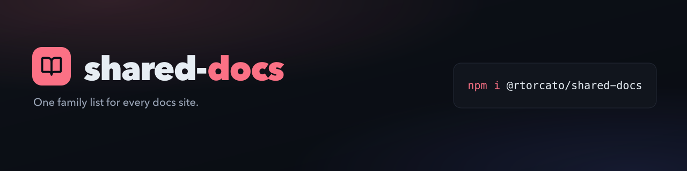

<!-- brand-kit:banner:start -->
<picture>
  <source media="(max-width: 640px)" srcset="./brand/banner-mobile.png">
  
</picture>
<!-- brand-kit:banner:end -->

# @rtorcato/shared-docs

Shared data and helpers for the `@rtorcato` docs sites — the framework-neutral
sibling-family list and nav/footer builders, plus Docusaurus components.

[](https://buymeacoffee.com/rtorcato)

The single source of truth for the **sibling-family list** — the cross-links
every `@rtorcato/*` docs site shows in its nav, footer, and landing grid. Edit
the family once here; each site picks it up on its next build.

## Install

```sh
pnpm add -D @rtorcato/shared-docs
```

Published to npm as a normal semver package. There's no install-time build step
(no `allowBuilds` allowlisting needed in consumers). Update with
`pnpm update @rtorcato/shared-docs`.

> **Migrating from the git dependency?** Earlier versions of this README
> recommended `github:rtorcato/shared-docs`, which resolves to whatever is
> currently on `main` — unpinned, and updated with no release step in between.
> Replace it with the npm dep above. That path no longer works: `dist/` is not
> committed, and the git dep has no build step.

## Usage

**Docusaurus config** (`docusaurus.config.ts`) — nav dropdown + footer:

```ts
import { projectFamilyItems } from '@rtorcato/shared-docs'

const PROJECT_FAMILY = projectFamilyItems() // { label, href }[]

// navbar dropdown:
{ type: 'dropdown', label: 'Projects', items: [{ label: 'All on GitHub →', href: GITHUB_PROFILE }, ...PROJECT_FAMILY] }
// footer column:
{ title: 'Projects', items: PROJECT_FAMILY }
```

**Landing page** (`src/pages/index.tsx`) — "Sibling projects" grid, excluding
your own package:

```tsx
import { siblings, type FamilyMember } from '@rtorcato/shared-docs'

const SIBLINGS = siblings('@rtorcato/cf-common')
```

## Back to torcato.dev

Every family site links back to [torcato.dev](https://torcato.dev). Docusaurus has
no config slot before the logo, so a small theme plugin does it; a site adds one
line and swizzles nothing.

`shared-docs init` scaffolds both the plugin and `footerCopyright()` for new sites. `doctor`
warns on an older site that lacks the plugin; add the lines below by hand, since `init` never
rewrites an existing `docusaurus.config.ts`.

```ts
// docusaurus.config.ts
import { footerCopyright } from '@rtorcato/shared-docs'

plugins: ['@rtorcato/shared-docs/docusaurus'],
themeConfig: { footer: { copyright: footerCopyright() } },
```

- **Navbar:** a `torcato.dev /` breadcrumb before the site logo, on every page.
- **Mobile drawer:** `← torcato.dev` as the first row, above Docs. It wraps the
  drawer layout, so a site that swizzles `Navbar/MobileSidebar/PrimaryMenu` with its
  own list still gets it. Don't add the row to that list by hand.
- **Footer:** `footerCopyright()` puts a `← torcato.dev · Buy me a coffee` line above the copyright.
  It returns HTML (Docusaurus renders `footer.copyright` as HTML); `copyright()` stays
  plain text for non-Docusaurus callers.

Colour comes from `--jt-muted-strong`, added to `theme-tokens.css`. A site whose
copy predates it falls back to the same values; run `shared-docs init --update` to
refresh it. A site's own `src/theme/Navbar/Logo` or `Navbar/MobileSidebar/Layout`
overrides the plugin's.

## API

- `FAMILY: FamilyMember[]` — the full family (all packages, including each site's own).
- `siblings(selfName): FamilyMember[]` — the family minus one package, for a grid.
- `projectFamilyItems(): { label, href }[]` — nav/footer link items for the whole family.
- `label(member): string` — short label (package name without the `@rtorcato/` scope).
- `copyright(builtWith?): string` — footer copyright line, stamped with the current
  year. Defaults to `'Docusaurus'`; a Fumadocs site passes `copyright('Fumadocs')`.
- `GITHUB_PROFILE: string` — the `@rtorcato` GitHub profile URL.
- `FamilyMember` — `{ name, tagline, href, dest, accent }`.

Two behaviours worth knowing, both intentional:

- `siblings()` returns the **full list unchanged** if `selfName` isn't in `FAMILY`,
  so a typo makes a site render itself in its own grid. Pass the exact package name.
- `label()` only strips `@rtorcato/`. A member outside that scope renders as-is.

## Use with AI

This repo ships a self-contained agent skill so coding agents wire the nav, footer,
and sibling grid correctly — including the two footguns above.

**Any agent with the [`skills`](https://www.npmjs.com/package/skills) CLI** — one
command, straight from GitHub (no clone, no package install):

```sh
npx skills add https://github.com/rtorcato/shared-docs --skill shared-docs
```

Source: [`skills/shared-docs/SKILL.md`](./skills/shared-docs/SKILL.md).

## Adding / editing a sibling

Edit `src/family.ts` and commit. `dist/` is build output and isn't tracked —
`prepack` builds it at publish time.

Don't bump `version` or tag by hand — semantic-release does that from the commit
messages. Use `feat:` or `fix:`; a `chore:` or `docs:` commit publishes nothing, so
the change never reaches consumers. Sites then pick it up via
`pnpm update @rtorcato/shared-docs`.

**Merging to `main` does not release.** Releases are batched: closing a milestone, or
dispatching `release.yml` by hand, publishes everything merged since the last tag in
one release.

> The `version` field in `package.json` is **deliberately stale** — nothing commits
> the bump back to `main`. `npm view @rtorcato/shared-docs version` and the newest
> git tag are the real answer.

## Colour and theming

This repo's components consume `--ifm-*`/`--jt-*` colour tokens; `repo-tooling`'s
`tooling/docusaurus/` owns the theme that defines them. See "Boundary with
repo-tooling" in `CLAUDE.md` before adding CSS.

## CLI

`shared-docs` scaffolds a Docusaurus docs site wired to this package. It has no
runtime dependencies (node built-ins only) and never prompts.

```sh
npx @rtorcato/shared-docs init      # apps/docs: theme, tokens, Projects dropdown, family footer,
                                    # landing page with <Siblings>, mobile drawer, TS 7-ready tsconfig
npx @rtorcato/shared-docs doctor    # report drift from the scaffold (exit 1 on failures)
```

The site URL and deploy target come from `.repo-tooling.json`
`record.config.docs.{url, deploy}` when present (the CLI only reads it), else
the `--url` / `--deploy` flags (which also override the file), else
`https://<owner>.github.io/<repo>/` deployed to GitHub Pages. `deploy` is
`github`, `cloudflare` (repo-tooling's Cloudflare reusable workflow; needs the
`CLOUDFLARE_API_TOKEN` / `CLOUDFLARE_ACCOUNT_ID` secrets) or `none` (no
workflow). `doctor` checks the Docusaurus `url`/`baseUrl` and the workflow
against those settings.

Brand assets (banner, social card, favicon) live in
[`@rtorcato/brand-kit`](https://github.com/rtorcato/brand-kit): run
`npx @rtorcato/brand-kit` to write `brand/`, then `shared-docs init` copies the
favicon and social card into `apps/docs/static/img`. `shared-docs brand` is a
deprecated alias that only points there.

Options: `--dir`, `--tagline`, `--accent` / `--accent-dark` (hex), `--typedoc`,
`--helpers`, `--update`, `--json`, `--yes` (accepted for parity; nothing prompts).
Tagline and accent default to the package's `FAMILY` entry, then `package.json`.
Files are only written when missing, so re-running never overwrites hand edits.
`init --update` is the exception: it replaces the shipped verbatim assets
(`theme.css`, `_jt-tokens.css`, `scripts/*.mjs`) that `doctor` flags as drifted,
and still never touches the generated config, pages or other editable files.
